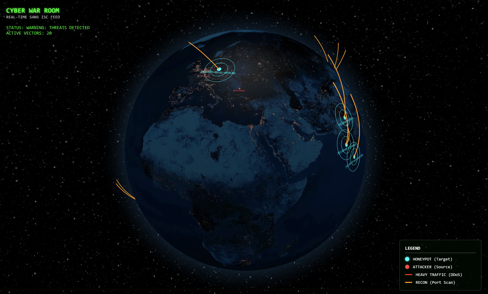

# CyberThreatMap

> An evidence-first 3D globe of source IPs reported to the SANS Internet Storm Center.



## What you are looking at

The map shows **IP addresses that were reported to SANS ISC / DShield**, placed at their approximate GeoIP location. It deliberately does **not** claim more than the data supports:

- The feed is **aggregated source activity** (a top-sources list), not a live packet stream and not a source-to-destination attack log. A source appearing in the latest poll does not mean an attack "just happened".
- **No attack routes are drawn from the real data.** SANS does not say where each source attacked, so there is no real destination to draw.
- **No attack type is claimed.** Records are classified `unknown` ("Reported source activity") because the feed reports none. Earlier versions guessed DoS/scan/exploit from `count / attacks`; that was not supported by the data and was removed.
- **GeoIP is approximate.** Many IPs share one coarse city/country coordinate, so they are grouped into a single marker instead of being jittered to invented positions. IPs with no GeoIP result stay in the list as "Location unavailable".
- A **Simulated routes** toggle (off by default) draws illustrative arcs to hard-coded demo cities. It is bannered `SIMULATED ROUTES`, never counted as data, and the cities are not honeypots or victims.

### Field meanings (SANS ISC)

| Our field | SANS field | Meaning |
|---|---|---|
| `metrics.reportCount` | `count` | Number of reports for this source |
| `metrics.targetCount` | `attacks` | Number of targets reported |
| `time.firstSeen` / `lastSeen` | `firstseen` / `lastseen` | Provider dates (day precision), preserved as given |
| `time.fetchedAt` | — | When *our server* fetched the data (never mixed with provider times) |

Definitions follow the [SANS sources page](https://isc.sans.edu/sources/) and [API docs](https://isc.sans.edu/api/).

## Architecture

```
SANS ISC API ──poll 60s──▶ server (Express + Socket.IO) ──'snapshot'──▶ React + react-globe.gl
                           │  collector  (timeout, bounded retries)
                           │  normalizer (schema + GeoIP via geoip-lite)
                           │  feed       (in-memory snapshot, health, backoff)
                           └─ GET /health
```

- **No database.** The latest snapshot lives in memory; a new client receives it immediately on connect.
- **Polling** is sequential (cycles never overlap), starts immediately on boot, repeats every `POLL_INTERVAL_MS` (default 60 s) and backs off exponentially (max 10 min) while the provider fails. HTTP 429 is not retried within a cycle.
- **Feed health** is separate from the observation list: `loading | ok | error`, plus `stale` (no success for 3 intervals), `lastAttemptAt`, `lastSuccessAt`, and a coded error. A valid empty response is `ok` with 0 observations; a failure keeps the previous snapshot and reports `error`.
- **Frontend** groups observations by shared coordinates, shows a zoom-aware number of city labels (6 when zoomed out, up to 60 when close), and offers a searchable source list and detail card. Category colours come from one map in `client/src/theme.js`.

### Observation shape

```js
{
  id: 'sans-isc:203.0.113.10', provider: 'sans-isc',
  observedEntity: { ip },
  geo: { countryCode, countryName, region, city, latitude, longitude, precision: 'city|region|country|unknown' },
  metrics: { reportCount, targetCount },
  time: { firstSeen, lastSeen, providerTimestamp: null, fetchedAt },
  classification: { category: 'unknown', basis: 'unknown', label, evidence },
  destination: null            // only set if a provider ever ties a record to a destination
}
```

## Run locally

Prerequisites: Node 18+ (tested on 24), npm.

```bash
# terminal 1
cd server && npm install && npm start      # http://localhost:4000 (GET /health)

# terminal 2
cd client && npm install && npm start      # http://localhost:3000
```

No database, API key or account is needed.

### Environment variables

| Where | Variable | Default | Purpose |
|---|---|---|---|
| server | `PORT` | `4000` | Listen port |
| server | `ALLOWED_ORIGINS` | `http://localhost:3000,http://127.0.0.1:3000` | Comma-separated CORS origins (HTTP + Socket.IO). **Set this to your deployed frontend URL in production**; `*` allows all |
| server | `POLL_INTERVAL_MS` | `60000` | SANS poll interval |
| server | `SANS_URL` | SANS top-20 sources endpoint | Override feed URL |
| client | `REACT_APP_BACKEND_URL` | `http://127.0.0.1:4000` | Backend URL (build-time) |

See `server/.env.example` and `client/.env.example`.

### Tests

```bash
cd server && npm test                       # node:test, fixtures only, no network
cd client && CI=true npm test -- --watchAll=false && npm run build
```

## Deployment note

`render.yaml` is unchanged in topology. Because CORS is no longer `*` by default, set `ALLOWED_ORIGINS` on the Render backend to the frontend's origin (for example the Vercel URL) **before** deploying this branch, otherwise the browser will be refused.

## Known limitations

- SANS data is a rolling top-N aggregate; first/last seen are dates, not timestamps.
- GeoIP (geoip-lite / MaxMind GeoLite) is coarse and sometimes wrong.
- Only SANS ISC is integrated. Threat-intel layers (e.g. Feodo Tracker C2 matches) and on-demand enrichment (GreyNoise, AbuseIPDB) are designed for (`classification.basis`) but not yet implemented.
- The globe textures load from unpkg; if blocked, the globe renders without imagery.
- The globe canvas has no automated test; see the manual QA checklist below.

### Manual QA checklist

- Loads with the globe visible; header shows `Connecting` then `Feed healthy`.
- Zoom out: few labels. Zoom in: more labels. Click a marker/label → location card; click an IP → detail card.
- Search an IP in the list → it is selected and the globe focuses it.
- Stop the server → status shows `Server disconnected · showing last data`; restart → recovers without reload.
- Toggle *Simulated routes* → orange banner and legend entry appear; the source count does not change.
- OS "reduce motion" on → no auto-rotate, no pulsing rings.
- Narrow window (<760 px) → list becomes the *Sources* drawer.

## Credits

- Data: [SANS Internet Storm Center](https://isc.sans.edu) (DShield). Please review their [terms and attribution guidance](https://isc.sans.edu/feeds_doc.html).
- GeoIP: [geoip-lite](https://github.com/geoip-lite/node-geoip) (MaxMind GeoLite data).
- Visualisation: [globe.gl](https://globe.gl) / three.js.
- Inspiration: an [IBM video](https://youtu.be/z503nLsfe5s) on DDoS attacks.
